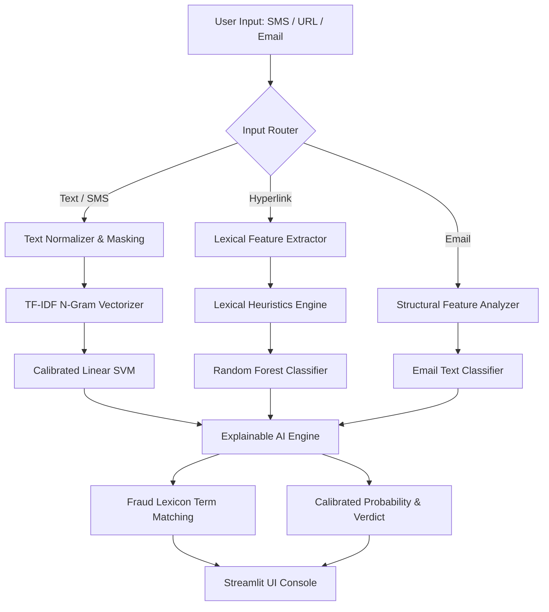

# 🛡️ AI Shield — Unified & Explainable Fraud Detection Platform

<div align="center">

[](https://ai-shield.streamlit.app/)
[](https://www.python.org/)
[](https://scikit-learn.org/)
[](LICENSE)
[](https://skillsbuild.org/)
[](https://sdgs.un.org/)

**A Unified, Multi-Vector Machine Learning System for Real-Time Detection of Scam Messages, Phishing URLs, and Fraudulent Emails with Explainable AI (XAI).**

### 🚀 **[Try the Live Web Application: ai-shield.streamlit.app](https://ai-shield.streamlit.app/)**

---
</div>

## 📌 Executive Summary

Digital communications have become the primary attack surface for social engineering, financial exploitation, and cybercrime. Fraudulent campaigns routinely combine **urgent SMS threats (fake KYC/SBI alerts)**, **obfuscated phishing hyperlinks**, and **counterfeit corporate emails**. 

**AI Shield** provides an integrated, transparent cyber defense console that inspects multi-modal inputs, assigns calibrated risk probabilities, and delivers human-interpretable reasoning (Explainable AI) so non-technical users and analysts understand *why* an input was flagged.

Developed as the Capstone Project for the **AICTE | IBM SkillsBuild Machine Learning & Applied AI Internship 2026**, in collaboration with **BharatCares (CSRBOX)**.

---

## 🎯 Sustainable Development Goals (SDGs)

* **SDG 9 — Industry, Innovation & Infrastructure:** Strengthening security and resilience across public digital infrastructure and fintech payment rails (UPI, internet banking).
* **SDG 16 — Peace, Justice & Strong Institutions:** Mitigating cyber-enabled extortion, predatory online scams, and unauthorized financial asset transfers.

---

## ⚡ Core Capabilities

| Vector | Detection Capability | Under the Hood |
| :--- | :--- | :--- |
| **💬 Scam Messages** | Detects bank KYC blocks, lottery baits, UPI extortion, and digital arrest coercion | TF-IDF (1–2 n-grams) + Calibrated Linear SVM (Platt scaling) + Fraud Lexicon Engine |
| **🔗 Phishing URLs** | Identifies IP-in-hostname, URL shorteners, excessive subdomains, and credential theft paths | Lexical Feature Extraction (12 & 8 features) + Random Forest Ensemble |
| **📧 Fraud Emails** | Assesses corporate impersonation and urgent account modification requests | Structural Link/Domain Profiling + Enron-trained Linear SVM Classifier |
| **📊 Threat Intelligence** | Global threat insights across industries, attack vectors, and financial losses (2015–2024) | Interactive Multi-Sector Analytics Dashboard (3,000 audited incidents) |

---

## 🔬 Rigorous Data Science: The Leakage & Quality Audit

A cornerstone of this project is **empirical honesty**. Rather than reporting artificially inflated metrics on unverified datasets, a comprehensive audit pipeline (`eda.py`) was conducted:

1. **Composite Scam Dataset Leakage Purge:**
   * Found that **17% of total records were duplicates** and **2,900 out of 9,188 test rows were present in training data**.
   * Exact-duplicate leakage was fully purged prior to model training to guarantee true out-of-sample generalization.
2. **GCT 100K Dataset Exclusion:**
   * Audited the *Global Cognitive Threat (GCT 100K)* dataset and proved the labels were synthetic noise: a text classifier achieved exactly **49.9% accuracy (pure coin toss)**. The dataset was completely excluded from production models.
3. **Purely Lexical URL Engineering:**
   * Excluded network-dependent features (domain age, live WHOIS lookup) that introduce latency or reveal user browsing to malicious command-and-control servers. All features are deterministically computable from the URL string.

---

## 📊 Model Benchmark Scorecard

All metrics are reproducible via `python train.py`:

| Module | Dataset | Model Architecture | Metric 1 | Metric 2 | Generalization |
| :--- | :--- | :--- | :--- | :--- | :--- |
| **Scam Text** | Composite Scam Transcripts (30,540 train / 5,949 leak-free test) | **Linear SVM** (Platt-Calibrated) | **Accuracy: 99.7%** | **F1: 0.998** | Short SMS: 98.8% F1, Long transcripts: 99.9% |
| **Phishing URL (UCI)** | 11,055 URLs (UCI Lexical features) | **Random Forest** (8 Features) | **ROC-AUC: 0.83** | **F1: 0.74** | Resilient against sub-domain spoofing |
| **Phishing URL (Basic)** | 1,354 URLs | **Random Forest** (12 Features) | **ROC-AUC: 0.81** | **F1: 0.59** | Specialized for IP & path length flags |
| **Email Text** | Enron Fraud Labeled (10,451 samples) | **Linear SVM** + Structural Extractor | **Holdout F1: 0.88** | **PR-AUC: 0.86** | Marked *Experimental* (domain shift documented) |

---

## 🏗️ System Architecture



---

## 📂 Repository Structure

```text
├── app.py                  # Main Streamlit web application
├── train.py                # Model training, hyperparameter comparison, and audit pipeline
├── eda.py                  # Exploratory Data Analysis & figure generator
├── requirements.txt        # Production Python dependencies
├── render.yaml             # Render 1-click deployment specification
├── Procfile                # Web process start command
├── pytest.ini              # Test runner configuration
├── .streamlit/             # Theme tokens and cloud server configuration
├── src/aishield/           # Core library
│   ├── config.py           # Paths, random seeds, and dataset definitions
│   ├── text_clean.py       # HTML stripping, URL token masking, and normalisation
│   ├── url_features.py     # Deterministic lexical feature extractor & red flags
│   ├── email_features.py   # Structural email analysis (links, urgency counts)
│   ├── predict.py          # Prediction pipeline + Explainable AI (XAI) engine
│   └── evaluate.py         # Performance metric computation utilities
├── models/                 # Pre-trained joblib model artifacts (~11.5 MB total)
├── data/sample/            # Verified sample CSVs & Cyber Threats dataset (3,000 rows)
├── reports/                # Metrics JSON, training logs, and 11 evaluation figures
├── docs/submission/        # Capstone deliverables (Concept Note, PPT, Lean Canvas)
└── tests/                  # Pytest test suite
```

---

## 🛠️ Quickstart: Run Locally

### 1. Clone the repository
```bash
git clone https://github.com/Karthik-Siraparapu-1/AI-Shield.git
cd AI-Shield
```

### 2. Set up virtual environment
Using `uv` (ultra-fast):
```bash
uv venv --python 3.11 .venv
source .venv/bin/activate
uv pip install -r requirements.txt pytest
```
Or standard `pip`:
```bash
python3 -m venv .venv
source .venv/bin/activate
pip install -r requirements.txt pytest
```

### 3. Run the unit tests
```bash
pytest tests/test_ai_shield.py
```
*(All 6 unit tests execute in ~1 second with zero warnings).*

### 4. Launch the web application
```bash
streamlit run app.py
```
Open your browser at `http://localhost:8501`.

---

## 🌐 Cloud Deployment

### Deploy on Streamlit Community Cloud (Recommended)
1. Fork or push this repository to GitHub.
2. Go to [share.streamlit.io](https://share.streamlit.io).
3. Select your repository, set branch to `main`, and main file path to `app.py`.
4. Click **Deploy**.

### Deploy on Render
1. Connect your repository to [dashboard.render.com](https://dashboard.render.com).
2. Render automatically detects [render.yaml](render.yaml).
3. Click **Create Web Service**.

---

## 👨‍💻 Author & Credits

* **Author:** Karthik Siraparapu
* **Institution:** Marwadi University
* **Internship Program:** AICTE | IBM SkillsBuild Machine Learning & Applied AI Internship 2026
* **Internship ID:** `IBMUEML004123`
* **Partner Organization:** BharatCares (CSRBOX)

---

## ⚖️ Disclaimer

*AI Shield is an educational machine learning prototype developed for academic evaluation. It does not replace professional guidance from banks, law enforcement, or national cybersecurity agencies. In India, report cybercrime to [cybercrime.gov.in](https://cybercrime.gov.in) or call the National Cyber Crime Helpline at **1930**.*
